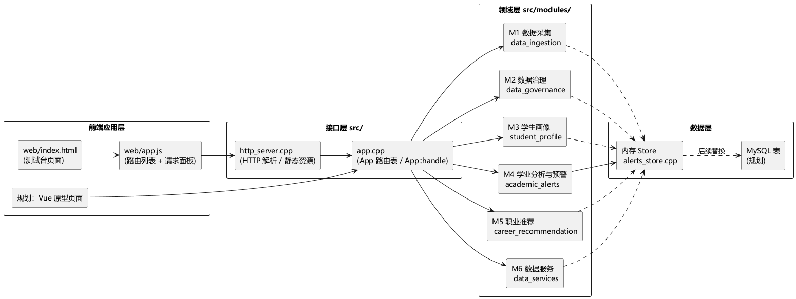
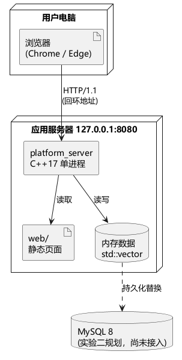
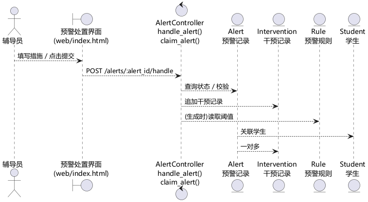
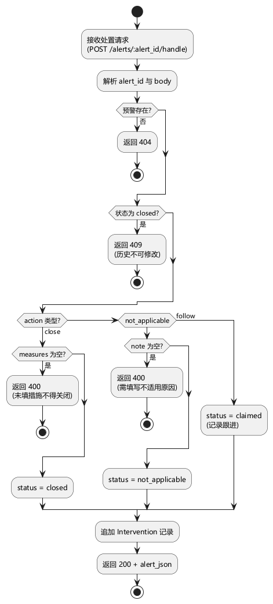

# 二、设计规格说明书

> **课程**：《软件工程课程实验（2026）》
> **题目**：高校学生成长与职业发展数据中台（`student_growth_platform`）
> **组别**：第 3 组
> **组长**：吴承霖
> **小组成员**：董治民、魏恩睿、刘家庚、吴子凡
> **完成日期**：2026 年 11 月 16 日

---

## 目录

- [1  概述（Summary）](#1--概述summary)
  - [1.1 系统定位与设计目标](#11-系统定位与设计目标)
  - [1.2 模块划分与设计范围](#12-模块划分与设计范围)
  - [1.3 设计方法与设计原则](#13-设计方法与设计原则)
- [2  总体设计（Design of Collective）](#2--总体设计design-of-collective)
  - [2.1 体系结构设计（Design of Architecture）](#21--体系结构设计design-of-architecture)
    - [2.1.1 架构决策与选型](#211-架构决策与选型)
    - [2.1.2 系统逻辑架构](#212-系统逻辑架构)
    - [2.1.3 系统物理架构](#213-系统物理架构)
  - [2.2 模块设计（Module Design）](#22--模块设计module-design)
    - [2.2.1 核心用例实现模型（全员覆盖）](#221-核心用例实现模型全员覆盖)
    - [2.2.2 全系统设计类清单](#222-全系统设计类清单)
- [3  数据库设计（Design of Database）](#3--数据库设计design-of-database)
  - [3.1 数据库表设计（DB Table Design）](#31--数据库表设计db-table-design)
    - [3.1.1 类模型向关系模型映射转换方案](#311-类模型向关系模型映射转换方案)
    - [3.1.2 数据库表名清单（全系统 18 张表）](#312-数据库表名清单全系统-18-张表)
  - [3.2 数据库表的详细清单（12 张核心数据字典）](#32--数据库表的详细清单12-张核心数据字典)

---

## 1  概述（Summary）

### 1.1 系统定位与设计目标
高校学生在校期间的学习、科研、实践与就业数据长期分散在教务、科研、学工、实践平台及就业等多个纵向业务系统中，普遍存在“一人多号、一数多源、口径分散固化、画像缺失粗放、服务缺乏复用与统一授权”等瓶颈问题。这不仅导致教工重复排查数据、学生多平台重复填表，更使学业风险预警滞后、就业匹配推荐缺乏量化依据。

本项目旨在构建一个以“学生”为唯一主体、以“指标口径可配置”为核心、以“数据服务可授权”为出口的高校学生成长与职业发展数据中台：向下统一接入并治理多源异构数据，向上以能力画像、分析预警、职业推荐与数据服务的形式，全方位赋能学生、辅导员、院系与就业指导中心四大主体，实现“一次治理、多处复用”。

本设计规格说明书依据《实验一 需求规格说明书》确立的需求基线（包含 43 个用例、34 个用户故事、23 个分析类与 8 项非功能需求），将概念模型全面转化为具体的技术体系结构、对象交互模型、组件依赖模型与关系数据库物理模型。

### 1.2 模块划分与设计范围
系统划分为六个核心业务模块以及公共接口支撑层，并明确团队 5 位成员的主责分工：
1. **M1 数据采集与接入模块（魏恩睿主责）**：多源外部数据登记、字段映射规则、导入任务执行、批次稽核与原始记录入库；
2. **M2 数据治理与标准化模块（董治民主责）**：质量规则配置、多源主数据清洗归并、指标口径动态配置与版本化重算；
3. **M3 学生画像模块（魏恩睿主责）**：多维能力标签体系维护、画像指标计算、六维雷达图与画像快照呈现；
4. **M4 学业分析与预警模块（刘家庚主责）**：群体学业分析看板、预警规则匹配、谈话处置流转与闭环跟踪；
5. **M5 职业发展推荐模块（吴子凡主责）**：用人单位岗位库维护、学生能力画像加权匹配、可解释性理由生成与去向统计；
6. **M6 数据服务与权限管理模块（吴承霖主责）**：基于 Token 的用户鉴权、RBAC 角色权限与数据范围隔离、API 目录与版本管理、网关限流、动态数据脱敏与全流程审计。

### 1.3 设计方法与设计原则
1. **面向对象与 UML 规范建模**：采用包图表达逻辑架构、部署图表达物理架构、鲁棒图与序列图表达用例实现模型、活动图表达核心算法逻辑；
2. **分层解耦与依赖倒置**：严格实施“接口适配层 → 领域业务层 → 仓储抽象层 → 底层存储引擎”的分层架构，业务逻辑不直接依赖具体数据库；
3. **极简自洽与开箱即用**：针对单机演示与无专职运维的实际教学约束，选用现代 C++17 分层单体架构，内嵌轻量 HTTP 路由引擎并内置 SQLite3 源码，克隆即可编译运行。

---

## 2  总体设计（Design of Collective）

### 2.1  体系结构设计（Design of Architecture）

#### 2.1.1 架构决策与选型

针对 5 人敏捷开发小组、8 周研发周期、单机无专职运维环境以及 Sprint 增量交付的严苛约束，对三种备选方案进行多维度权衡评估：

**表 2-1　软件体系结构选型方案对比**

| 架构方案 | 体系结构与技术栈 | 优势 | 劣势及对约束的支持程度 | 决策结论 |
|---|---|---|---|:---:|
| **A. 分层单体架构（选用）** | 现代 C++17 + 内嵌 HTTP Server + 模块路由表 + 嵌入式 SQLite3 | • 零外部中间件与容器依赖，单机编译即运行； • 模块以路由插槽与独立目录物理隔离，支持 5 人并行开发； • 编译构建极快（Ninja 构建 < 10 秒），调试直观。 | • 单进程并发吞吐量存在物理上限； • 但教学演示 QPS 需求低，完全满足性能指标（NFR-01/02）。 | **最优选择 （确定采用）** |
| **B. 前后端分离 + Java Spring Boot** | Spring Boot 3 + MyBatis + MySQL + Vue 3 单页 | • 生态成熟，Java 领域对象与 CRUD 库丰富； • 前端组件库成熟，页面开发门槛低。 | • 需额外部署 JDK 17+、Maven、MySQL 8 独立服务； • 早期 demo1 原型核查显示环境配置与排错成本高，不利于极速集成。 | 备选方案 （不采用） |
| **C. 微服务分布式架构** | Spring Cloud / Go-gRPC + API 网关 + 独立数据库集群 | • 服务治理粒度细，单模块容灾与弹性伸缩能力极佳； • 模块技术栈可独立演进。 | • 引入分布式事务、服务发现、链路追踪等极大复杂度； • 8 周内团队无法承担服务编排与运维，严重违反工期约束。 | 彻底否决 （不可行） |

**决策结论**：选定 **方案 A：分层单体架构** 作为核心体系结构。

#### 2.1.2 系统逻辑架构

严格遵循《软件工程实验指导书》关于“选题三：高校学生成长与职业发展数据中台”的架构设计要求——“**需明确采用分层架构，区分数据采集层、数据处理层、数据服务层与前端应用层，并用包图表示逻辑架构**”，本项目逻辑架构划分为四大核心功能层次，辅以底层统一数据存储基础设施，各层遵循“自上而下单向依赖、下层对上层透明、跨层禁止穿透、数据自下而上流转”的严谨原则。系统总体逻辑架构包图如图 2-1 所示：

*图 2-1　系统总体逻辑架构包图（四层中台架构）*

各层次职责划分、内部包含的核心功能包及与 5 位小组成员职责映射详细说明如下：

1. **前端应用层（Frontend Application Layer）**
   - 面向学生、辅导员、院系管理员、就业指导中心教师及外部第三方消费系统提供直观的交互界面与展现服务：
   - **API 调试台与测试工作台**（`web/index.html` + `app.js`）：提供中台所有 RESTful 接口的参数可视化配置、单点调用测试与响应 JSON 格式化校验；
   - **数据服务与安全管理面板**（`web/data-services.html`）：面向系统管理员与第三方调用方，提供开放数据服务目录检索、RBAC 角色权限配置、调用配额监控及令牌管理；
   - **职业推荐与学生交互看板**（`web/career.html`）：面向学生与导师，展示个人五维能力雷达图、岗位胜任力匹配推荐列表以及短板指标提升建议；
   - **学业预警大屏与辅导员工作台**（Alert Console & Dashboard）：面向院系辅导员，提供多维度预警学生过滤筛查、风险级别红黄橙预警展现及预警处置闭环工作台；
   - **第三方系统与前台消费端**（OpenAPI Consumers）：校内教工协同系统、综合评优评先系统等外部业务，通过 HTTP REST 协议以标准化 OpenAPI 方式消费中台数据服务。

2. **数据服务层（Data Service Layer · 核心成员：吴承霖 M6）**
   - 规划并实现中台面向前台应用提供数据服务的能力与开放 API，负责统一请求接入、安全边界防护、服务治理与合规审计：
   - **HTTP 网关监听与路由调度分发**（`HttpServer` & `AppRouter`）：基于手写轻量 Socket 引擎，实现高性能 TCP 连接监听、HTTP 报文解析、静态资源托管与 REST 动态路径参数精确分发；
   - **API 令牌鉴权与 RBAC 权限管控**（`security.hpp` & `AuthService`）：对所有外来调用执行严格的 Bearer Token 身份校验，结合基于角色的访问控制模型（RBAC）判定接口访问权限；
   - **开放数据服务目录与代理调用**（`DataServiceRegistry` & `ServiceProxy`）：集中维护已发布数据服务的元数据契约，负责将外部服务编码动态映射并代理路由到后端的具体业务处理器；
   - **敏感数据动态脱敏引擎**（`DataMasker`）：针对身份证号、联系电话、家庭住址等高敏感学生个人隐私数据，依据调用者所属角色的授权级别实施动态掩码脱敏；
   - **服务限流与访问配额控制**（`RateLimiter`）：采用令牌桶算法实现细粒度接口级与令牌级限流保护，防止前台高并发脉冲请求击穿中台服务；
   - **全链路安全审计日志引擎**（`AuditLogger`）：对每一次接口调用的发起者、调用路径、入参摘要、响应状态码与执行耗时执行安全留痕与合规落库。

3. **数据处理层（Data Processing Layer · 核心中台业务能力）**
   - 承载数据中台的核心业务模型、算法逻辑与领域能力，实现多源数据的标准化治理、学生全维度画像建模、学业风险预警处置与职业匹配推荐：
   - **数据治理与标准化包（M2 董治民）**：包含多源数据清洗转换器（`DataCleaner`）、数据质量规则校验稽核引擎（`QualityRuleEngine`）以及学生主数据治理归并（`StudentMasterService`），实现“一人一档”唯一学号的主数据融合去重与质量把控；
   - **学生画像与档案包（M3 魏恩睿）**：包含五维能力评分建模引擎（`StudentProfileEngine`，覆盖德/智/体/美/劳维度）、多维指标度量与聚合计算（`MetricCalculator`）以及画像指标快照与版本追溯管理（`ProfileSnapshotManager`）；
   - **学业分析与预警包（M4 刘家庚）**：包含学业异常触发规则引擎（`AlertRuleEngine`，支持挂科门数、积点低于阈值等多维预警规则）、基于有限状态机（FSM）的预警处置流转（`AlertHandler`）以及谈话记录与干预追踪闭环（`InterventionService`）；
   - **职业发展与推荐包（M5 吴子凡）**：包含职业岗位技能标准知识库（`JobCatalogService`）、基于学生能力画像的加权相似度匹配算法（`CompetencyMatcher`）以及岗位推荐理由解释与成长路径规划（`CareerRecommender`）。

4. **数据采集层（Data Collection Layer · 核心成员：魏恩睿 M1）**
   - 解决高校各业务系统长期存在的“数据烟囱”难题，负责与异构源系统建立连接通道，实现多源异构数据的抽取、批处理导入调度与原始缓冲：
   - **多源异构数据接入适配器**（`DataSourceAdapter`）：包含教务系统学业采集适配器（`AcademicAdapter`，对接成绩与选课）、学工系统素质采集适配器（`StudentAffairsAdapter`，对接考勤、处分与荣誉）以及一卡通与实践日志采集适配器（`CampusCardAdapter`，对接刷卡规律与实践记录）；
   - **采集调度与导入批处理引擎**（`ImportTaskManager`）：负责多源数据采集批次的生命周期调度、导入进度跟踪、全量/增量任务执行及异常中断重试；
   - **原始数据解析与结构校验器**（`DataParser & Validator`）：针对多源异构的 JSON/CSV 文件流执行语法解析与结构有效性校验；
   - **原始数据暂存与缓冲池**（`RawDataBuffer / IngestionBuffer`）：在原始数据被清洗加工之前提供无损落地区域，保障中台数据处理全链路具备历史追溯与重算能力。

5. **统一数据存储层（Data Storage Layer · 全系统基础设施底座）**
   - 由统一的 `SqliteRepository` 与数据访问对象（DAO）抽象接口组成，依托嵌入式轻量关系数据库 `platform.db`（直接链接 SQLite3 C 核心源码），为采集暂存、治理规则、主数据、能力指标快照、预警干预记录、岗位知识库及审计日志提供严格的 ACID 关系事务持久化保障。

#### 2.1.3 系统物理架构

系统物理架构遵循极简与单机闭环原则，如图 2-2 所示：

*图 2-2　系统物理架构部署图*

* **客户端节点（Client Device）**：运行现代标准 Web 浏览器，通过 HTTP/1.1 协议向应用服务器发起 RESTful 格式请求；
* **应用服务器节点（Application Server）**：单机运行的核心可执行文件 `platform_server`，作为单进程运行于开发或测试主机。服务默认仅监听本机回环地址（`127.0.0.1:8080`），防止局域网未授权探测；
* **嵌入式数据存储（Embedded Storage）**：应用直接集成编译 SQLite 动态引擎，以进程内句柄访问本地数据文件 `platform.db`，读写无网络开销，零配置启动。

---

## 2.2  模块设计（Module Design）

为了充分体现全组 5 位成员的独立设计产出，本节按模块分别选取核心用例，建立鲁棒图、时序序列图、程序逻辑活动图与内部组件架构图。

### 2.2.1 核心用例实现模型（全员覆盖）

#### 1. M4 学业分析与预警模块：UC-AA-05 处置预警（刘家庚）
* **鲁棒分析**：将预警处置用例分解为 `AlertHandleUI` 边界对象、`handle_alert` 控制对象以及 `AlertRecord`、`InterventionRecord` 等实体对象，职责划分如图 2-3 所示：

*图 2-3　预警处置用例鲁棒图（M4 模块 · 刘家庚）*

* **时序序列设计**：辅导员通过界面发起预警认领、跟进或结案处置。序列图详尽刻画了控制器对 `AlertStore` 的协调过程，特别覆盖了 404（不存在）、409（结案不可改）、400（未填措施/原因）三条异常分支处理：

*图 2-4　预警处置时序序列图（含 400/404/409 异常分支 · 刘家庚）*

* **程序逻辑活动图**：预警处置的核心程序逻辑在于严格受控的有限状态机流转。针对辅导员的处置动作，程序执行“存在性检查 → 关闭态防篡改拦截 → 必填参数校验 → 状态迁移 → 留痕落盘”流水线：

*图 2-5　预警处置关键程序逻辑活动图（M4 模块 · 刘家庚）*

* **内部组件架构**：M4 模块内部进行了精细的微内核组件解耦，各组件源码结构及依赖关系如图 2-6 所示：

*图 2-6　M4 模块内部组件与依赖关系图（刘家庚）*

#### 2. M6 数据服务与权限管理模块：UC-DS-06 网关调用与动态脱敏（吴承霖）
吴承霖在 `gateway.cpp` 与 `security.cpp` 中实现了中台核心的安全防线。该时序图完整展示了外部请求接入网关、Bearer Token 身份认证、滑动时间窗口限流防刷、RBAC 角色权限与数据范围隔离、敏感字段（身份证/手机号/成绩）动态脱敏，以及原子化记录安全审计流水账本的全过程：

*图 2-7　数据服务网关调用与动态脱敏时序序列图（M6 模块 · 吴承霖）*

#### 3. M3 学生画像与标签模块：UC-SP-02 学生画像指标计算与快照（魏恩睿）
魏恩睿在 `student_profile/service.cpp` 中实现了“指标—标签—画像”三层计算引擎。该时序图展现了按学期读取清洗后主数据、计算德智体美劳科研六维分值、匹配能力标签阈值规则，并版本化持久化为 ProfileSnapshot 快照的完整时序：

*图 2-8　学生多维画像计算与快照生成时序序列图（M3 模块 · 魏恩睿）*

#### 4. M5 职业发展推荐模块：UC-CD-04 岗位能力加权匹配推荐（吴子凡）
吴子凡在 `recommendations.cpp` 中实现了岗位与画像的匹配推荐算法。该时序图清晰呈现了通过 ProfileAdapter 从 M3 模块读取能力指标分值并进行量纲归一化（0~100 标准分）、比对用人单位招聘岗位达标线、计算加权匹配度、生成雷达差距与可解释文本理由的闭环时序：

*图 2-9　岗位能力加权匹配推荐与解释生成序列图（M5 模块 · 吴子凡）*

#### 5. M2 数据治理与标准化模块：UC-DG-03/07 数据质量清洗与主数据归并（董治民）
董治民在 `quality_rules.cpp` 与 `student_master.cpp` 中实现了数据治理核心链路。该活动图详尽描述了多源原始采集数据加载、正则与完整性校验、严重错误熔断阻断、学生学号/身份证号多标识实体对齐清洗归并（一人一档）以及指标口径重算触发的严密控制逻辑：

*图 2-10　数据质量校验与主数据归并活动图（M2 模块 · 董治民）*

---

### 2.2.2 全系统设计类清单

整理鲁棒图、时序序列图与代码实现模型，归纳涵盖 M1～M6 全系统的核心设计类清单（如表 2-2 所示）：

**表 2-2　全系统核心设计类清单（涵盖 M1～M6 全模块）**

| 序号 | 所属模块 | 实体类（Entity） | 对应控制类（Control） | 对应边界类（Boundary） | 仓储实现类（Repository） |
|:---:|---|---|---|---|---|
| 1 | M1 数据接入 | DataSource, ImportTask, RawRecord | ImportTaskService | 数据源配置界面 / 导入执行看板 | SqliteDataSourceRepository |
| 2 | M1 数据接入 | FieldMapping, ImportBatch | FieldMappingService | 字段规则映射界面 | SqliteDataSourceRepository |
| 3 | M2 数据治理 | QualityRule, QualityReport | QualityRuleService | 质量规则维护 / 治理报告看板 | SqliteGovernanceRepository |
| 4 | M2 数据治理 | StudentMaster, MetricDef | StudentMasterService, MetricService | 主数据对齐视图 / 口径重算控制台 | SqliteGovernanceRepository |
| 5 | M3 学生画像 | StudentProfile, MetricValue | ProfileService::calculate | 学生成长多维雷达图界面 | SqliteProfileRepository |
| 6 | M3 学生画像 | StudentTag, TagDefinition | ProfileService::match_tags | 能力标签依据溯源抽屉 | SqliteProfileRepository |
| 7 | M3 学生画像 | ProfileSnapshot | ProfileService::export_report | 个人成长画像导出报告面板 | SqliteProfileRepository |
| 8 | M4 分析预警 | AlertRecord, AlertRule | AlertController::handle_alert | 预警分级处置工作台 | AlertStore / IAlertRepository |
| 9 | M4 分析预警 | InterventionRecord | AlertController::claim_alert | 预警名单与干预时间线 | AlertStore / IAlertRepository |
| 10 | M4 分析预警 | AcademicDashboard | AlertController::dashboard | 院系/班级学业预警总览看板 | AlertStore / IAlertRepository |
| 11 | M5 职业推荐 | JobCatalog, JobRequirement | CareerCatalog::manage_jobs | 用人单位岗位发布与维护界面 | SqliteCareerRepository |
| 12 | M5 职业推荐 | RecommendationRecord | RecommendEngine::recommend | 学生职业匹配推荐与反馈界面 | SqliteCareerRepository |
| 13 | M5 职业推荐 | CareerOutcome | OutcomeAnalytics::statistics | 就业去向分布与历年趋势看板 | SqliteCareerRepository |
| 14 | M6 数据服务 | SysUser, SysRole, Session | SecurityCenter::verify_token | 统一登录鉴权弹框 | DataServicesStore |
| 15 | M6 数据服务 | DataService, ServiceGrant | ServiceRegistry::publish | 数据服务目录与审批工作台 | DataServicesStore |
| 16 | M6 数据服务 | AuditLog, RateLimiter | GatewayProxy::invoke | 网关调用限流与安全审计控制台 | DataServicesStore |

---

## 3  数据库设计（Design of Database）

### 3.1  数据库表设计（DB Table Design）

#### 3.1.1 类模型向关系模型映射转换方案
1. **实体映射**：概念模型中的独立业务实体映射为独立关系表；
2. **关联关系与外键映射**：1:N 关系在“多”端数据表中建立外键（Foreign Key）列，引用“一”端的主键；M:N 关系拆分为独立关联表；
3. **状态与枚举**：统一采用 `VARCHAR(16)` 短字符串存储（如 `red/orange/yellow`、`open/claimed/closed`），保证自解释性与扩展性；
4. **数值精度**：指标得分与规则阈值采用 `DECIMAL(10,2)` 或 `DOUBLE`，避免浮点精度丢失；
5. **审计规范**：业务主表均配备 `id` 自增主键、`created_at` 与 `updated_at` 时间戳。

#### 3.1.2 数据库表名清单（全系统 18 张表）

**表 2-3　数据库表名清单（全系统全量 18 张表）**

| 序号 | 中文表名 | 英文表名 | 所属模块 | 主键定义 | 表功能说明 |
|:---:|---|---|---|---|---|
| 1 | 数据源配置表 | `data_source` | M1 数据接入 | id (BIGINT PK) | 登记接入的教务、科研、实践等外部数据源连接与类型元数据 |
| 2 | 数据导入任务表 | `import_task` | M1 数据接入 | id (BIGINT PK) | 记录外部数据导入任务的调度周期、映射规则与执行状态 |
| 3 | 原始采集记录表 | `raw_record` | M1 数据接入 | id (BIGINT PK) | 归档各数据源导入的原始未经清洗的数据行，保留校验错误标记 |
| 4 | 数据质量规则表 | `quality_rule` | M2 数据治理 | id (BIGINT PK) | 定义完整性、唯一性、格式等校验规则及自动清洗处置策略 |
| 5 | 学生主数据表 | `student_master` | M2 数据治理 | id (BIGINT PK) | 多源异构身份归并清洗后的唯一学生主档案（一人一档基线） |
| 6 | 指标口径定义表 | `metric_def` | M2 数据治理 | id (BIGINT PK) | 配置综合成绩、学分完成率等核心指标的计算公式、权重与版本 |
| 7 | 学生基础画像表 | `student_profile` | M3 学生画像 | id (BIGINT PK) | 维护学生基础档案镜像、年级班级与当前核心画像标签汇总 |
| 8 | 指标计算值表 | `metric_value` | M3 学生画像 | id (BIGINT PK) | 持久化存储周期性指标重算的历史值快照，支撑雷达图对比 |
| 9 | 能力标签定义表 | `tag_definition` | M3 学生画像 | id (BIGINT PK) | 定义学生能力标签（如学术尖子、学业危险等）及其触发规则 |
| 10 | 画像综合快照表 | `profile_snapshot` | M3 学生画像 | id (BIGINT PK) | 版本化保存学生在特定学期的雷达图能力分值与导出归档 |
| 11 | 学业预警规则表 | `alert_rule` | M4 分析预警 | id (BIGINT PK) | 配置预警等级、触发指标、比较符、判定阈值与责任通知人 |
| 12 | 预警事件记录表 | `alert_record` | M4 分析预警 | id (BIGINT PK) | 记录各批次触发的学业预警明细、当前处置状态及触发指标快照 |
| 13 | 干预处置留痕表 | `intervention_record` | M4 分析预警 | id (BIGINT PK) | 辅导员认领、谈话跟进、结案关闭等全生命周期处置操作流水 |
| 14 | 职业岗位库表 | `job_catalog` | M5 职业推荐 | id (BIGINT PK) | 登记用人单位招聘岗位基础信息、行业分类、招聘年级与状态 |
| 15 | 岗位能力要求表 | `job_requirement` | M5 职业推荐 | id (BIGINT PK) | 配置各岗位对学生画像能力标签的权重、最低达标分与策略 |
| 16 | 推荐历史记录表 | `recommendation_record` | M5 职业推荐 | id (BIGINT PK) | 记录为学生生成的匹配推荐得分、缺失项分析及学生意向反馈 |
| 17 | 系统用户角色表 | `sys_user_role` | M6 数据服务 | id (BIGINT PK) | 管理系统账号（学生/辅导员/院系）、密码摘要、角色及数据范围 |
| 18 | 数据服务审计表 | `data_service_audit` | M6 数据服务 | id (BIGINT PK) | 注册数据服务 API 目录、授权审批令牌以及调用限流审计流水 |

---

### 3.2 数据库表的详细清单（12 张核心数据字典）

**表 2-4　表名：alert_rule（学业预警规则表 · M4）**

| 序号 | 字段中文名 | 字段英文名 | 类型与精度 | 取值约束 | 空否 | 默认值 | 主/外键 | 索引说明 |
|:---:|---|---|---|---|:---:|:---:|:---:|---|
| 1 | 规则ID | `id` | BIGINT | 自增序列 | 否 | — | PK | PRIMARY |
| 2 | 规则编码 | `rule_code` | VARCHAR(16) | R1, R2 等唯一代号 | 否 | — | — | UNIQUE(rule_code) |
| 3 | 规则名称 | `name` | VARCHAR(64) | 如“综合不及格门数预警” | 否 | — | — | — |
| 4 | 监控指标 | `metric` | VARCHAR(32) | avg_score, failed_courses | 否 | — | — | INDEX(metric, level) |
| 5 | 运算符 | `operator` | VARCHAR(8) | lt, lte, gt, gte | 否 | lt | — | — |
| 6 | 判定阈值 | `threshold` | DECIMAL(10,2) | >= 0.00 | 否 | 0.00 | — | — |
| 7 | 预警等级 | `level` | VARCHAR(8) | red, orange, yellow | 否 | yellow | — | — |
| 8 | 通知对象 | `notify_target` | VARCHAR(128) | 角色或用户类型 | 是 | NULL | — | — |
| 9 | 是否启用 | `enabled` | TINYINT | 0-禁用, 1-启用 | 否 | 1 | — | INDEX(enabled) |
| 10 | 创建时间 | `created_at` | DATETIME | UTC 时间戳 | 否 | CURRENT_TIMESTAMP | — | — |

**表 2-5　表名：alert_record（学业预警记录表 · M4）**

| 序号 | 字段中文名 | 字段英文名 | 类型与精度 | 取值约束 | 空否 | 默认值 | 主/外键 | 索引说明 |
|:---:|---|---|---|---|:---:|:---:|:---:|---|
| 1 | 预警ID | `id` | BIGINT | 自增序列 | 否 | — | PK | PRIMARY |
| 2 | 学号 | `student_id` | VARCHAR(20) | 关联学生主数据 | 否 | — | FK | INDEX(student_id) |
| 3 | 规则ID | `rule_id` | BIGINT | 关联预警规则 | 否 | — | FK | INDEX(rule_id) |
| 4 | 预警等级 | `level` | VARCHAR(8) | red, orange, yellow | 否 | — | — | INDEX(level) |
| 5 | 处置状态 | `status` | VARCHAR(16) | open, claimed, closed, not_applicable | 否 | open | — | INDEX(status, created_at) |
| 6 | 触发指标值 | `metric_value` | DECIMAL(10,2) | 触发时的实际指标得分 | 否 | — | — | — |
| 7 | 触发时间 | `created_at` | DATETIME | UTC 时间戳 | 否 | CURRENT_TIMESTAMP | — | — |
| 8 | 认领人 | `assignee` | VARCHAR(32) | 认领处置的辅导员账号 | 是 | NULL | — | — |
| 9 | 结案时间 | `closed_at` | DATETIME | 处置完成归档时间 | 是 | NULL | — | — |

**表 2-6　表名：intervention_record（干预处置留痕表 · M4）**

| 序号 | 字段中文名 | 字段英文名 | 类型与精度 | 取值约束 | 空否 | 默认值 | 主/外键 | 索引说明 |
|:---:|---|---|---|---|:---:|:---:|:---:|---|
| 1 | 记录ID | `id` | BIGINT | 自增序列 | 否 | — | PK | PRIMARY |
| 2 | 预警ID | `alert_id` | BIGINT | 关联具体预警事件 | 否 | — | FK | INDEX(alert_id) |
| 3 | 处置动作 | `action` | VARCHAR(16) | claim, follow, close, not_applicable | 否 | — | — | — |
| 4 | 干预措施 | `measures` | VARCHAR(500) | 约谈与帮扶措施（close必填） | 是 | NULL | — | — |
| 5 | 排除说明 | `note` | VARCHAR(500) | 特殊情况原因说明（not_applicable必填） | 是 | NULL | — | — |
| 6 | 操作人工号 | `operator` | VARCHAR(32) | 辅导员工号或姓名 | 否 | — | — | — |
| 7 | 操作时间 | `created_at` | DATETIME | 操作时间戳 | 否 | CURRENT_TIMESTAMP | — | INDEX(alert_id, created_at) |

**表 2-7　表名：student_master（学生主数据表 · M2/M1）**

| 序号 | 字段中文名 | 字段英文名 | 类型与精度 | 取值约束 | 空否 | 默认值 | 主/外键 | 索引说明 |
|:---:|---|---|---|---|:---:|:---:|:---:|---|
| 1 | 学生主键 | `id` | BIGINT | 自增序列 | 否 | — | PK | PRIMARY |
| 2 | 统一学号 | `sno` | VARCHAR(20) | 全校唯一学籍号 | 否 | — | — | UNIQUE(sno) |
| 3 | 学生姓名 | `name` | VARCHAR(32) | 真实姓名 | 否 | — | — | — |
| 4 | 性别 | `gender` | VARCHAR(4) | 男, 女 | 否 | 男 | — | — |
| 5 | 所属学院 | `college` | VARCHAR(64) | 学院标准全称 | 否 | — | — | INDEX(college) |
| 6 | 专业名称 | `major` | VARCHAR(64) | 专业全称 | 否 | — | — | — |
| 7 | 行政班级 | `clazz` | VARCHAR(32) | 如“软件2101” | 否 | — | — | INDEX(clazz) |
| 8 | 入学年级 | `grade` | INT | 四位年份，如 2021 | 否 | — | — | INDEX(grade) |
| 9 | 在籍状态 | `status` | VARCHAR(16) | active, suspended, graduated | 否 | active | — | — |

**表 2-8　表名：data_source（数据源配置表 · M1）**

| 序号 | 字段中文名 | 字段英文名 | 类型与精度 | 取值约束 | 空否 | 默认值 | 主/外键 | 索引说明 |
|:---:|---|---|---|---|:---:|:---:|:---:|---|
| 1 | 数据源ID | `id` | BIGINT | 自增序列 | 否 | — | PK | PRIMARY |
| 2 | 数据源编号 | `source_code` | VARCHAR(32) | 如 DS_JW_01 | 否 | — | — | UNIQUE(source_code) |
| 3 | 数据源名称 | `name` | VARCHAR(64) | 如“教务系统成绩库” | 否 | — | — | — |
| 4 | 业务类型 | `category` | VARCHAR(16) | academic, research, practice | 否 | — | — | INDEX(category) |
| 5 | 接入方式 | `access_type` | VARCHAR(16) | file_import, api_push, db_sync | 否 | file_import | — | — |
| 6 | 连接配置 | `config_json` | TEXT | 包含路径或鉴权参数 | 是 | NULL | — | — |
| 7 | 启用状态 | `enabled` | TINYINT | 0-停用, 1-启用 | 否 | 1 | — | — |

**表 2-9　表名：import_task（数据导入任务表 · M1）**

| 序号 | 字段中文名 | 字段英文名 | 类型与精度 | 取值约束 | 空否 | 默认值 | 主/外键 | 索引说明 |
|:---:|---|---|---|---|:---:|:---:|:---:|---|
| 1 | 任务ID | `id` | BIGINT | 自增序列 | 否 | — | PK | PRIMARY |
| 2 | 数据源编号 | `source_code` | VARCHAR(32) | 关联数据源配置 | 否 | — | FK | INDEX(source_code) |
| 3 | 任务状态 | `status` | VARCHAR(16) | pending, running, success, partial, failed | 否 | pending | — | INDEX(status) |
| 4 | 总记录数 | `total_count` | INT | >= 0 | 否 | 0 | — | — |
| 5 | 成功记录数 | `success_count` | INT | >= 0 | 否 | 0 | — | — |
| 6 | 失败记录数 | `failed_count` | INT | >= 0 | 否 | 0 | — | — |
| 7 | 导入时间 | `executed_at` | DATETIME | 执行批次时间戳 | 否 | CURRENT_TIMESTAMP | — | — |

**表 2-10　表名：quality_rule（数据质量规则表 · M2）**

| 序号 | 字段中文名 | 字段英文名 | 类型与精度 | 取值约束 | 空否 | 默认值 | 主/外键 | 索引说明 |
|:---:|---|---|---|---|:---:|:---:|:---:|---|
| 1 | 质量规则ID | `id` | BIGINT | 自增序列 | 否 | — | PK | PRIMARY |
| 2 | 规则代号 | `rule_code` | VARCHAR(32) | 如 QR_NOT_NULL_01 | 否 | — | — | UNIQUE(rule_code) |
| 3 | 校验表名 | `target_table` | VARCHAR(64) | raw_record / student_master | 否 | — | — | INDEX(target_table) |
| 4 | 校验字段 | `target_field` | VARCHAR(64) | 待检查字段名称 | 否 | — | — | — |
| 5 | 规则类型 | `rule_type` | VARCHAR(16) | not_null, unique, regex, range | 否 | not_null | — | — |
| 6 | 表达式参数 | `rule_param` | VARCHAR(256) | 正则表达式或数值区间 | 是 | NULL | — | — |
| 7 | 处置等级 | `action_level` | VARCHAR(16) | block, warning, auto_fix | 否 | warning | — | — |

**表 2-11　表名：metric_value（指标计算值表 · M3/M2）**

| 序号 | 字段中文名 | 字段英文名 | 类型与精度 | 取值约束 | 空否 | 默认值 | 主/外键 | 索引说明 |
|:---:|---|---|---|---|:---:|:---:|:---:|---|
| 1 | 指标值ID | `id` | BIGINT | 自增序列 | 否 | — | PK | PRIMARY |
| 2 | 学号 | `student_id` | VARCHAR(20) | 关联学生主数据 | 否 | — | FK | INDEX(student_id, term) |
| 3 | 学年学期 | `term` | VARCHAR(16) | 如 2024-2025-1 | 否 | — | — | — |
| 4 | 指标编码 | `metric_code` | VARCHAR(32) | programming, avg_score 等 | 否 | — | — | INDEX(metric_code) |
| 5 | 原始数值 | `raw_value` | DECIMAL(10,2) | 计算前原始数值 | 否 | 0.00 | — | — |
| 6 | 归一分值 | `score` | DECIMAL(5,2) | 0.00 ~ 100.00 | 否 | 0.00 | — | — |
| 7 | 计算时间 | `calculated_at` | DATETIME | 重算时间戳 | 否 | CURRENT_TIMESTAMP | — | — |

**表 2-12　表名：job_catalog（职业岗位库表 · M5）**

| 序号 | 字段中文名 | 字段英文名 | 类型与精度 | 取值约束 | 空否 | 默认值 | 主/外键 | 索引说明 |
|:---:|---|---|---|---|:---:|:---:|:---:|---|
| 1 | 岗位ID | `id` | BIGINT | 自增序列 | 否 | — | PK | PRIMARY |
| 2 | 岗位名称 | `title` | VARCHAR(64) | 如“C++ 后端开发工程师” | 否 | — | — | — |
| 3 | 所属行业 | `industry` | VARCHAR(32) | 互联网, 金融科技等 | 否 | — | — | INDEX(industry) |
| 4 | 最低学历 | `min_degree` | VARCHAR(16) | bachelor, master, doctor | 否 | bachelor | — | — |
| 5 | 岗位状态 | `status` | VARCHAR(16) | draft, published, closed | 否 | draft | — | INDEX(status) |
| 6 | 岗位说明 | `description` | TEXT | 职责与任职资格描述 | 是 | NULL | — | — |
| 7 | 创建时间 | `created_at` | DATETIME | UTC 时间戳 | 否 | CURRENT_TIMESTAMP | — | — |

**表 2-13　表名：job_requirement（岗位能力要求表 · M5）**

| 序号 | 字段中文名 | 字段英文名 | 类型与精度 | 取值约束 | 空否 | 默认值 | 主/外键 | 索引说明 |
|:---:|---|---|---|---|:---:|:---:|:---:|---|
| 1 | 要求ID | `id` | BIGINT | 自增序列 | 否 | — | PK | PRIMARY |
| 2 | 所属岗位ID | `job_id` | BIGINT | 关联岗位库 | 否 | — | FK | INDEX(job_id) |
| 3 | 能力项编码 | `competency_code` | VARCHAR(32) | programming, databases 等 | 否 | — | — | — |
| 4 | 权重占比 | `weight` | DECIMAL(4,2) | 0.00 ~ 1.00 | 否 | 1.00 | — | — |
| 5 | 最低达标线 | `benchmark_score` | DECIMAL(5,2) | 0.00 ~ 100.00 | 否 | 60.00 | — | — |

**表 2-14　表名：data_service（数据服务目录表 · M6）**

| 序号 | 字段中文名 | 字段英文名 | 类型与精度 | 取值约束 | 空否 | 默认值 | 主/外键 | 索引说明 |
|:---:|---|---|---|---|:---:|:---:|:---:|---|
| 1 | 服务ID | `id` | BIGINT | 自增序列 | 否 | — | PK | PRIMARY |
| 2 | 服务名称 | `name` | VARCHAR(64) | 如“学生综合画像查询接口” | 否 | — | — | — |
| 3 | 接口路径 | `path` | VARCHAR(128) | 全系统唯一路由 | 否 | — | — | UNIQUE(path) |
| 4 | 服务版本 | `version` | VARCHAR(16) | v1, v2 | 否 | v1 | — | — |
| 5 | 调用方式 | `method` | VARCHAR(8) | GET, POST | 否 | GET | — | — |
| 6 | 流控配额 | `rate_limit_per_min` | INT | 单客户端每分钟上限 | 否 | 60 | — | — |
| 7 | 状态 | `status` | VARCHAR(16) | active, deprecated | 否 | active | — | — |

**表 2-15　表名：data_service_audit（数据服务调用与审计表 · M6）**

| 序号 | 字段中文名 | 字段英文名 | 类型与精度 | 取值约束 | 空否 | 默认值 | 主/外键 | 索引说明 |
|:---:|---|---|---|---|:---:|:---:|:---:|---|
| 1 | 日志流水ID | `id` | BIGINT | 自增序列 | 否 | — | PK | PRIMARY |
| 2 | 服务路径 | `path` | VARCHAR(128) | 调用的 API 路由 | 否 | — | — | INDEX(path) |
| 3 | 调用账号 | `caller_id` | VARCHAR(32) | 用户账号或应用 AppKey | 否 | — | — | INDEX(caller_id) |
| 4 | 请求方式 | `method` | VARCHAR(8) | GET, POST 等 | 否 | GET | — | — |
| 5 | 响应状态码 | `status_code` | INT | 如 200, 401, 403, 429 | 否 | — | — | INDEX(status_code) |
| 6 | 脱敏标识 | `is_masked` | TINYINT | 0-明文, 1-已动态脱敏 | 否 | 1 | — | — |
| 7 | 客户端IP | `client_ip` | VARCHAR(45) | IPv4 或 IPv6 | 否 | — | — | — |
| 8 | 调用时间 | `created_at` | DATETIME | 调用发生时间 | 否 | CURRENT_TIMESTAMP | — | INDEX(created_at) |
