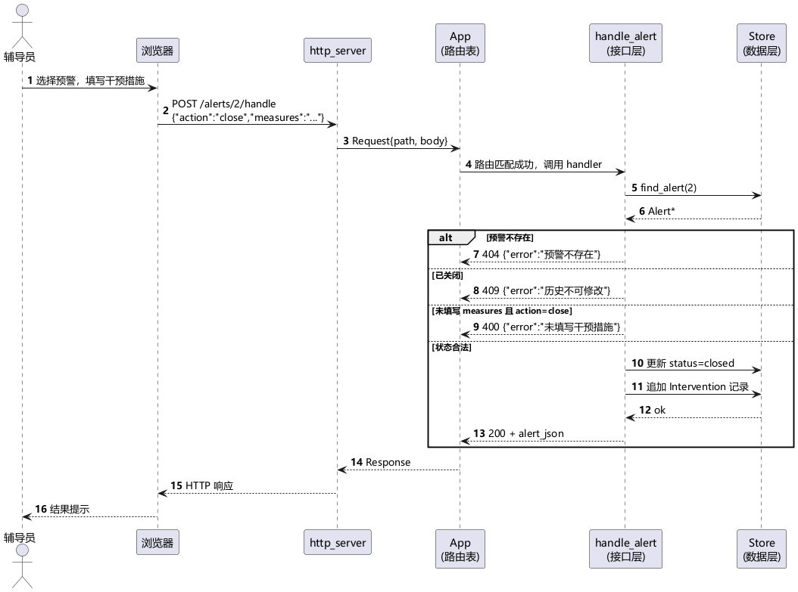
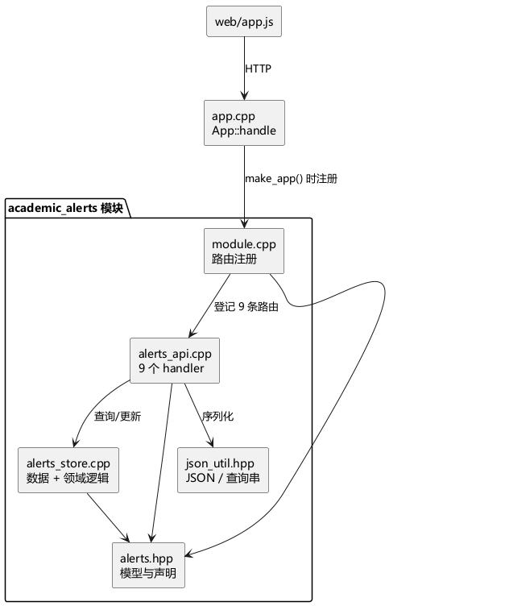

# 二、设计规格说明书

> **课程**：《软件工程课程实验（2026）》
> **题目**：高校学生成长与职业发展数据中台（`student_growth_platform`）
> **组别**：第 3 组
> **组长**：吴承霖
> **小组成员**：董治民、魏恩睿、刘家庚、吴子凡
> **完成日期**：2026 年 11 月 16 日

---

## 目录

- [1  概述（Summary）](#1--概述summary)
  - [1.1 系统定位与设计目标](#11-系统定位与设计目标)
  - [1.2 模块划分与设计范围](#12-模块划分与设计范围)
  - [1.3 设计方法与设计原则](#13-设计方法与设计原则)
- [2  总体设计（Design of Collective）](#2--总体设计design-of-collective)
  - [2.1 体系结构设计（Design of Architecture）](#21--体系结构设计design-of-architecture)
    - [2.1.1 架构决策与选型](#211-架构决策与选型)
    - [2.1.2 系统逻辑架构](#212-系统逻辑架构)
    - [2.1.3 系统物理架构](#213-系统物理架构)
  - [2.2 模块设计（Module Design）](#22--模块设计module-design)
    - [2.2.1 用例实现（设计模型）](#221-用例实现设计模型)
    - [2.2.2 关键程序逻辑设计](#222-关键程序逻辑设计)
- [3  数据库设计（Design of Database）](#3--数据库设计design-of-database)
  - [3.1 数据库表设计（DB Table Design）](#31--数据库表设计db-table-design)
    - [3.1.1 类模型向关系模型映射转换方案](#311-类模型向关系模型映射转换方案)
    - [3.1.2 数据库表名清单](#312-数据库表名清单)
  - [3.2 数据库表的详细清单（Particular List of DB Table）](#32--数据库表的详细清单particular-list-of-db-table)

---

## 1  概述（Summary）

### 1.1 系统定位与设计目标
高校学生在校期间的学习、科研、实践与就业数据长期分散在教务、科研、学工、实践平台及就业等多个纵向业务系统中，普遍存在“一人多号、一数多源、口径分散固化、画像缺失粗放、服务缺乏复用与统一授权”等瓶颈问题。

本项目旨在构建一个以“学生”为唯一主体、以“指标口径可配置”为核心、以“数据服务可授权”为出口的高校学生成长与职业发展数据中台：向下统一接入并治理多源异构数据，向上以能力画像、分析预警、职业推荐与数据服务的形式，全方位赋能学生、辅导员、院系与就业指导中心四大主体，实现“一次治理、多处复用”。

本阶段工作依据《实验一 需求规格说明书》确定的需求基线（43 个用例、34 个用户故事、23 个分析类与 8 项非功能需求），将概念模型与需求规约全面转化为具体的技术体系结构、对象交互模型、组件依赖模型与关系数据库物理模型。

### 1.2 模块划分与设计范围
系统划分为六个核心业务模块以及公共接口支撑层：
1. **M1 数据采集与接入（Data Ingestion）**：负责多源外部数据的登记、字段映射、导入任务执行、批次稽核与原始记录入库；
2. **M2 数据治理与标准化（Data Governance）**：负责数据质量校验规则配置、多源主数据清洗归并、指标口径动态配置与重算；
3. **M3 学生画像（Student Profile）**：负责能力标签体系、综合成绩与多维指标计算、多维雷达图与画像快照呈现；
4. **M4 学业分析与预警（Academic Alerts）**：面向辅导员与院系提供群体分析看板，并实现学业风险的分级触发、处置与闭环跟踪；
5. **M5 职业发展推荐（Career Recommendation）**：基于学生能力画像与岗位技能要求进行加权匹配，提供推荐解释、学生反馈与去向趋势分析；
6. **M6 数据服务与权限管理（Data Services & Security）**：提供基于 Bearer Token 的用户认证、RBAC 角色权限与数据范围隔离、API 目录与版本管理、网关限流、敏感字段动态脱敏以及全流程审计。

**重点示范模块选型**：本次选择业务状态流转清晰、多角色交互完备的 **M4 学业分析与预警模块** 作为详细设计展开的核心代表。

### 1.3 设计方法与设计原则
1. **面向对象与 UML 规范建模**：采用包图表达逻辑架构、部署图表达物理架构、鲁棒图与序列图表达用例实现模型、活动图表达核心算法逻辑；
2. **分层解耦与依赖倒置**：严格实施“接口适配层 → 领域业务层 → 仓储抽象层 → 底层存储引擎”的分层架构，业务逻辑不依赖具体数据存储；
3. **极简自洽与开箱即用**：针对单机演示与无专职运维的实际教学约束，选用现代 C++17 分层单体架构，内嵌轻量 HTTP 路由引擎并内置 SQLite3 源码，克隆即可编译运行。

---

## 2  总体设计（Design of Collective）

### 2.1  体系结构设计（Design of Architecture）

#### 2.1.1 架构决策与选型

在满足 5 人团队、8 周工期、4 个 Sprint、单机教学演示部署与每个 Sprint 交付可运行增量等约束条件下，对三种备选方案进行综合技术权衡：

**表 2-1　软件体系结构选型方案对比**

| 方案 | 体系结构与技术栈 | 优势 | 劣势及对约束的支持程度 | 决策结论 |
|---|---|---|---|:---:|
| **A. 分层单体架构（选用）** | 现代 C++17 + 内嵌 HTTP Server + 模块路由表 + 嵌入式 SQLite3 | • 零外部中间件与容器依赖，单机编译即运行； • 模块以路由插槽与独立目录隔离，支持 5 人并行开发； • 编译构建极快（Ninja < 10s），调试直观。 | • 单进程并发吞吐量存在物理上限； • 但教学演示 QPS 需求低，完全满足性能指标（NFR-01/02）。 | **最优选择 （确定采用）** |
| **B. 前后端分离 + Java Spring Boot** | Spring Boot 3 + MyBatis + MySQL + Vue 3 单页 | • 生态成熟，开源 CRUD 组件库丰富； • 界面组件库成熟。 | • 需额外部署 JDK 17+、Maven、MySQL 8 服务； • 早期 demo1 核查显示学习与排错成本高，不利于极速集成。 | 备选方案 （不采用） |
| **C. 微服务分布式架构** | Spring Cloud / gRPC + API 网关 + 独立数据库集群 | • 服务治理粒度细，单模块容灾与弹性伸缩能力好； • 模块技术栈可独立演进。 | • 引入分布式事务、服务发现、链路追踪等极大复杂度； • 8 周内团队无法承担服务编排与运维，严重违反工期约束。 | 彻底否决 （不可行） |

**决策结论**：采用 **方案 A（分层单体架构）**。

#### 2.1.2 系统逻辑架构

系统逻辑架构采用严格的分层单体架构设计，自上而下划分为四层：

*图 2-1　系统逻辑架构包图*

1. **前端应用层（Presentation Layer）**：由 `web/index.html`（API 调试台）、`web/data-services.html`（权限控制台）、`web/career.html`（职业推荐页）构成，基于原生 ES6 JavaScript + CSS3 编写；
2. **接口适配与路由层（Interface & Adapter Layer）**：由 `http_server.cpp` 与 `app.cpp` 组成。负责底层 TCP Socket 监听、HTTP 报文解析、静态资源托管、请求分发与动态路径参数提取（如 `:student_id`）；
3. **领域业务层（Domain / Module Layer）**：包含 M1～M6 六大业务模块。各模块通过 `module.cpp` 暴露对外路由，内部由 Service 编排领域逻辑，模块间单向解耦；
4. **数据持久层（Persistence Layer）**：负责底层数据读写与事务保证，通过 SQLite3 嵌入式数据库（`data/platform.db`）或内存 Store 支撑。

#### 2.1.3 系统物理架构

系统物理架构遵循极简与单机闭环原则，如图 2-2 所示：

*图 2-2　系统物理架构部署图*

* **客户端节点（Client Device）**：运行标准 Web 浏览器，通过 HTTP/1.1 与应用交互；
* **应用服务器节点（Application Server）**：单机单进程运行 `platform_server`，默认仅监听本机回环地址（`127.0.0.1:8080`），防止局域网未授权探测；
* **嵌入式数据存储（Embedded Storage）**：应用直接集成编译 SQLite 动态引擎，以进程内句柄访问本地数据文件 `platform.db`，零配置启动。

---

### 2.2  模块设计（Module Design）

以重点模块 **M4 学业分析与预警** 之核心用例 **UC-AA-05 处置预警** 为例展开详细设计。

#### 2.2.1 用例实现（设计模型）

**1. 鲁棒分析（Robustness Analysis）**

通过鲁棒分析梳理用例中的边界、控制与实体对象：
* **边界对象**：`AlertHandlePage`（预警处置界面），捕获辅导员提交的处置表单；
* **控制对象**：`AlertHandler`（预警处置控制器），负责参数合法性校验、状态机流转控制与领域协调；
* **实体对象**：`AlertRecord`（预警记录实体）、`InterventionRecord`（干预留痕实体）、`AlertRule`（预警规则实体）、`Student`（学生基础实体）。

*图 2-3　处置预警用例鲁棒图*

**2. 动态交互设计（Sequence Diagram）**

绘制处置预警时序图，全面覆盖正常流程与三条典型异常分支：
* **正常分支**：辅导员提交处置动作，通过参数校验与状态校验后更新记录，插入干预留痕并返回 200 OK；
* **异常分支 1（记录不存在）**：传入无效 `alert_id`，返回 404 Not Found；
* **异常分支 2（状态冲突）**：对已处于 `closed` 状态的预警尝试再次操作，返回 409 Conflict；
* **异常分支 3（必填校验失败）**：执行 `action=close` 未填 `measures`，或执行 `action=not_applicable` 未填 `note`，返回 400 Bad Request。

*图 2-4　处置预警序列图（含 400/404/409 异常分支）*

**3. 设计类清单**

**表 2-2　设计类清单（M4 学业分析与预警模块）**

| 序号 | 实体类（Entity） | 对应控制类（Control） | 对应边界类（Boundary） |
|:---:|---|---|---|
| 1 | `AlertRecord`（预警记录） | `handle_alert()` / `claim_alert()` | 预警处置界面（AlertHandleUI） |
| 2 | `AlertRecord`（预警记录） | `list_alerts()` / `get_alert()` | 预警名单列表界面（AlertListUI） |
| 3 | `AlertRule`（预警规则） | `create_rule()` / `list_rules()` | 规则配置管理界面（RuleManageUI） |
| 4 | `InterventionRecord`（干预留痕） | `interventions()` | 干预跟踪时间线界面（InterventionUI） |
| 5 | `Student`（学生聚合） | `student_trend()` | 学业趋势分析看板（TrendDashboardUI） |
| 6 | `AcademicDashboard`（学业指标看板） | `dashboard()` | 班级学业预警总览看板（DashboardUI） |

#### 2.2.2 关键程序逻辑设计

**1. 状态机流转活动图**

预警处置涉及严格的有限状态机流转与业务分支判断，采用 UML 活动图描述如图 2-5 所示：

*图 2-5　处置预警关键程序逻辑活动图*

* **防历史篡改**：已结案（`closed`）的预警历史坚决不可修改（409）；
* **闭环可追溯**：结案必须填写约谈帮扶措施（`measures`），杜绝空单结案；
* **异常审计**：标记为不适用（`not_applicable`）必须填写原因（`note`），备查审计。

**2. 模块内部组件架构**

M4 内部组件与文件分层结构如图 2-6 所示：

*图 2-6　M4 模块内部组件与依赖关系图*

* `module.cpp`：仅负责模块注册与 RESTful 路由挂接；
* `alerts_api.cpp`：实现 HTTP Handler，负责入参校验与 JSON 报文响应；
* `alerts_store.cpp`：维护数据仓储，执行规则匹配引擎与状态机流转；
* `alerts.hpp`：领域结构体声明与常量定义；
* `json_util.hpp`：手写无依赖的轻量 JSON 工具类。

---

## 3  数据库设计（Design of Database）

### 3.1  数据库表设计（DB Table Design）

#### 3.1.1 类模型向关系模型映射转换方案
1. **实体映射**：概念模型中的独立业务实体映射为独立关系表；
2. **关系映射**：1:N 关系在“多”端添加外键列；M:N 关系拆分为独立关联表；
3. **状态与枚举**：统一采用 `VARCHAR(16)` 短字符串存储（如 `red/orange/yellow`、`open/claimed/closed`），保证自解释性与扩展性；
4. **数值精度**：指标得分与规则阈值采用 `DECIMAL(10,2)` 或 `DOUBLE`，避免浮点精度丢失；
5. **审计规范**：业务主表均配备 `id` 自增主键、`created_at` 与 `updated_at` 时间戳。

#### 3.1.2 数据库表名清单

**表 2-3　数据库表名清单（全系统全量 18 张表）**

| 序号 | 中文表名 | 英文表名 | 所属模块 | 表功能说明 |
|:---:|---|---|---|---|
| 1 | 数据源配置表 | `data_source` | M1 数据接入 | 登记接入的教务、科研、实践等外部数据源连接与类型元数据 |
| 2 | 数据导入任务表 | `import_task` | M1 数据接入 | 记录外部数据导入任务的调度周期、映射规则与执行状态 |
| 3 | 原始采集记录表 | `raw_record` | M1 数据接入 | 归档各数据源导入的原始未经清洗的数据行，保留校验错误标记 |
| 4 | 数据质量规则表 | `quality_rule` | M2 数据治理 | 定义完整性、唯一性、格式等校验规则及自动清洗处置策略 |
| 5 | 学生主数据表 | `student_master` | M2 数据治理 | 多源异构身份归并清洗后的唯一学生主档案（一人一档基线） |
| 6 | 指标口径定义表 | `metric_def` | M2 数据治理 | 配置综合成绩、学分完成率等核心指标的计算公式、权重与版本 |
| 7 | 学生基础画像表 | `student_profile` | M3 学生画像 | 维护学生基础档案镜像、年级班级与当前核心画像标签汇总 |
| 8 | 指标计算值表 | `metric_value` | M3 学生画像 | 持久化存储周期性指标重算的历史值快照，支撑雷达图对比 |
| 9 | 能力标签定义表 | `tag_definition` | M3 学生画像 | 定义学生能力标签（如学术尖子、学业危险等）及其触发规则 |
| 10 | 画像综合快照表 | `profile_snapshot` | M3 学生画像 | 版本化保存学生在特定学期的雷达图能力分值与导出归档 |
| 11 | 学业预警规则表 | `alert_rule` | M4 分析预警 | 配置预警等级、触发指标、比较符、判定阈值与责任通知人 |
| 12 | 预警事件记录表 | `alert_record` | M4 分析预警 | 记录各批次触发的学业预警明细、当前处置状态及触发指标快照 |
| 13 | 干预处置留痕表 | `intervention_record` | M4 分析预警 | 辅导员认领、谈话跟进、结案关闭等全生命周期处置操作流水 |
| 14 | 职业岗位库表 | `job_catalog` | M5 职业推荐 | 登记用人单位招聘岗位基础信息、行业分类、招聘年级与状态 |
| 15 | 岗位能力要求表 | `job_requirement` | M5 职业推荐 | 配置各岗位对学生画像能力标签的权重、最低达标分与策略 |
| 16 | 推荐历史记录表 | `recommendation_record` | M5 职业推荐 | 记录为学生生成的匹配推荐得分、缺失项分析及学生意向反馈 |
| 17 | 系统用户角色表 | `sys_user_role` | M6 数据服务 | 管理系统账号（学生/辅导员/院系）、密码摘要、角色及数据范围 |
| 18 | 数据服务审计表 | `data_service_audit` | M6 数据服务 | 注册数据服务 API 目录、授权审批令牌以及调用限流审计流水 |

---

### 3.2  数据库表的详细清单（Particular List of DB Table）

**表 2-4　表名：alert_rule（学业预警规则表）**

| 序号 | 字段中文名 | 字段英文名 | 类型与精度 | 取值约束 | 空否 | 默认值 | 主/外键 | 索引说明 |
|:---:|---|---|---|---|:---:|:---:|:---:|---|
| 1 | 规则ID | `id` | BIGINT | 自增序列 | 否 | — | PK | PRIMARY |
| 2 | 规则编码 | `rule_code` | VARCHAR(16) | R1, R2 等唯一代号 | 否 | — | — | UNIQUE(rule_code) |
| 3 | 规则名称 | `name` | VARCHAR(64) | 如“挂科预警” | 否 | — | — | — |
| 4 | 监控指标 | `metric` | VARCHAR(32) | avg_score/failed_courses | 否 | — | — | INDEX(metric, level) |
| 5 | 运算符 | `operator` | VARCHAR(8) | lt, lte, gt, gte | 否 | lt | — | — |
| 6 | 判定阈值 | `threshold` | DECIMAL(10,2) | >= 0.00 | 否 | 0.00 | — | — |
| 7 | 预警等级 | `level` | VARCHAR(8) | red, orange, yellow | 否 | yellow | — | — |
| 8 | 通知对象 | `notify_target` | VARCHAR(128) | 角色标识 | 是 | NULL | — | — |
| 9 | 是否启用 | `enabled` | TINYINT | 0-禁用, 1-启用 | 否 | 1 | — | INDEX(enabled) |
| 10 | 创建时间 | `created_at` | DATETIME | UTC 时间戳 | 否 | CURRENT_TIMESTAMP | — | — |

**表 2-5　表名：alert_record（学业预警记录表）**

| 序号 | 字段中文名 | 字段英文名 | 类型与精度 | 取值约束 | 空否 | 默认值 | 主/外键 | 索引说明 |
|:---:|---|---|---|---|:---:|:---:|:---:|---|
| 1 | 预警ID | `id` | BIGINT | 自增序列 | 否 | — | PK | PRIMARY |
| 2 | 学号 | `student_id` | VARCHAR(20) | 关联学生主数据 | 否 | — | FK | INDEX(student_id) |
| 3 | 规则ID | `rule_id` | BIGINT | 关联预警规则 | 否 | — | FK | INDEX(rule_id) |
| 4 | 预警等级 | `level` | VARCHAR(8) | red, orange, yellow | 否 | — | — | INDEX(level) |
| 5 | 处置状态 | `status` | VARCHAR(16) | open, claimed, closed, not_applicable | 否 | open | — | INDEX(status, created_at) |
| 6 | 触发指标值 | `metric_value` | DECIMAL(10,2) | 触发时的实际指标得分 | 否 | — | — | — |
| 7 | 触发时间 | `created_at` | DATETIME | UTC 时间戳 | 否 | CURRENT_TIMESTAMP | — | — |
| 8 | 认领人 | `assignee` | VARCHAR(32) | 认领处置的辅导员账号 | 是 | NULL | — | — |
| 9 | 结案时间 | `closed_at` | DATETIME | 处置完成归档时间 | 是 | NULL | — | — |

**表 2-6　表名：intervention_record（干预处置留痕表）**

| 序号 | 字段中文名 | 字段英文名 | 类型与精度 | 取值约束 | 空否 | 默认值 | 主/外键 | 索引说明 |
|:---:|---|---|---|---|:---:|:---:|:---:|---|
| 1 | 记录ID | `id` | BIGINT | 自增序列 | 否 | — | PK | PRIMARY |
| 2 | 预警ID | `alert_id` | BIGINT | 关联具体预警事件 | 否 | — | FK | INDEX(alert_id) |
| 3 | 处置动作 | `action` | VARCHAR(16) | claim, follow, close, not_applicable | 否 | — | — | — |
| 4 | 干预措施 | `measures` | VARCHAR(500) | 约谈与帮扶措施（close必填） | 是 | NULL | — | — |
| 5 | 排除说明 | `note` | VARCHAR(500) | 特殊情况原因说明 | 是 | NULL | — | — |
| 6 | 操作人工号 | `operator` | VARCHAR(32) | 辅导员工号或姓名 | 否 | — | — | — |
| 7 | 操作时间 | `created_at` | DATETIME | 操作时间戳 | 否 | CURRENT_TIMESTAMP | — | INDEX(alert_id, created_at) |

**表 2-7　表名：student_master（学生主数据表）**

| 序号 | 字段中文名 | 字段英文名 | 类型与精度 | 取值约束 | 空否 | 默认值 | 主/外键 | 索引说明 |
|:---:|---|---|---|---|:---:|:---:|:---:|---|
| 1 | 学生主键 | `id` | BIGINT | 自增序列 | 否 | — | PK | PRIMARY |
| 2 | 统一学号 | `sno` | VARCHAR(20) | 全校唯一学籍号 | 否 | — | — | UNIQUE(sno) |
| 3 | 学生姓名 | `name` | VARCHAR(32) | 真实姓名 | 否 | — | — | — |
| 4 | 性别 | `gender` | VARCHAR(4) | 男, 女 | 否 | 男 | — | — |
| 5 | 所属学院 | `college` | VARCHAR(64) | 学院标准名称 | 否 | — | — | INDEX(college) |
| 6 | 专业名称 | `major` | VARCHAR(64) | 专业全称 | 否 | — | — | — |
| 7 | 行政班级 | `clazz` | VARCHAR(32) | 如“软件2101” | 否 | — | — | INDEX(clazz) |
| 8 | 入学年级 | `grade` | INT | 四位年份，如 2021 | 否 | — | — | INDEX(grade) |
| 9 | 在籍状态 | `status` | VARCHAR(16) | active, suspended, graduated | 否 | active | — | — |

**表 2-8　表名：data_source（数据源配置表）**

| 序号 | 字段中文名 | 字段英文名 | 类型与精度 | 取值约束 | 空否 | 默认值 | 主/外键 | 索引说明 |
|:---:|---|---|---|---|:---:|:---:|:---:|---|
| 1 | 数据源ID | `id` | BIGINT | 自增序列 | 否 | — | PK | PRIMARY |
| 2 | 数据源编号 | `source_code` | VARCHAR(32) | 如 DS_JW_01 | 否 | — | — | UNIQUE(source_code) |
| 3 | 数据源名称 | `name` | VARCHAR(64) | 如“教务系统成绩库” | 否 | — | — | — |
| 4 | 业务类型 | `category` | VARCHAR(16) | academic, research, practice | 否 | — | — | INDEX(category) |
| 5 | 接入方式 | `access_type` | VARCHAR(16) | file_import, api_push, db_sync | 否 | file_import | — | — |
| 6 | 连接配置 | `config_json` | TEXT | 包含路径或鉴权参数 | 是 | NULL | — | — |
| 7 | 启用状态 | `enabled` | TINYINT | 0-停用, 1-启用 | 否 | 1 | — | — |

**表 2-9　表名：job_catalog（职业岗位库表）**

| 序号 | 字段中文名 | 字段英文名 | 类型与精度 | 取值约束 | 空否 | 默认值 | 主/外键 | 索引说明 |
|:---:|---|---|---|---|:---:|:---:|:---:|---|
| 1 | 岗位ID | `id` | BIGINT | 自增序列 | 否 | — | PK | PRIMARY |
| 2 | 岗位名称 | `title` | VARCHAR(64) | 如“C++ 后端开发工程师” | 否 | — | — | — |
| 3 | 所属行业 | `industry` | VARCHAR(32) | 互联网, 金融科技等 | 否 | — | — | INDEX(industry) |
| 4 | 最低学历 | `min_degree` | VARCHAR(16) | bachelor, master, doctor | 否 | bachelor | — | — |
| 5 | 岗位状态 | `status` | VARCHAR(16) | draft, published, closed | 否 | draft | — | INDEX(status) |
| 6 | 岗位说明 | `description` | TEXT | 职责与任职资格描述 | 是 | NULL | — | — |
| 7 | 创建时间 | `created_at` | DATETIME | UTC 时间戳 | 否 | CURRENT_TIMESTAMP | — | — |

**表 2-10　表名：data_service_audit（数据服务调用与审计表）**

| 序号 | 字段中文名 | 字段英文名 | 类型与精度 | 取值约束 | 空否 | 默认值 | 主/外键 | 索引说明 |
|:---:|---|---|---|---|:---:|:---:|:---:|---|
| 1 | 日志流水ID | `id` | BIGINT | 自增序列 | 否 | — | PK | PRIMARY |
| 2 | 服务路径 | `path` | VARCHAR(128) | 调用的 API 路由 | 否 | — | — | INDEX(path) |
| 3 | 调用账号 | `caller_id` | VARCHAR(32) | 用户账号或应用 AppKey | 否 | — | — | INDEX(caller_id) |
| 4 | 请求方式 | `method` | VARCHAR(8) | GET, POST 等 | 否 | GET | — | — |
| 5 | 响应状态码 | `status_code` | INT | 如 200, 401, 403, 429 | 否 | — | — | INDEX(status_code) |
| 6 | 脱敏标识 | `is_masked` | TINYINT | 0-明文, 1-已动态脱敏 | 否 | 1 | — | — |
| 7 | 客户端IP | `client_ip` | VARCHAR(45) | IPv4 或 IPv6 | 否 | — | — | — |
| 8 | 调用时间 | `created_at` | DATETIME | 调用发生时间 | 否 | CURRENT_TIMESTAMP | — | INDEX(created_at) |
