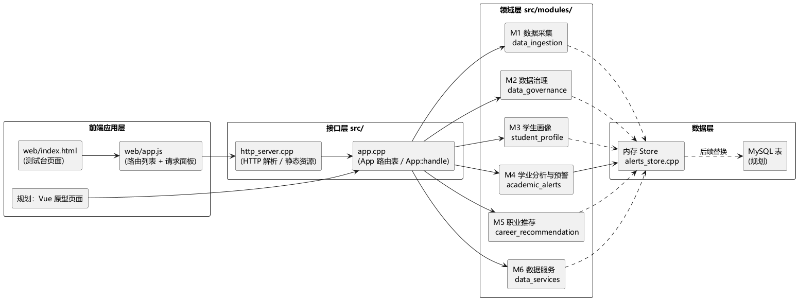
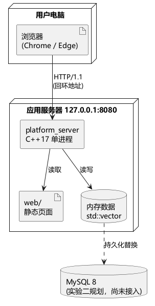
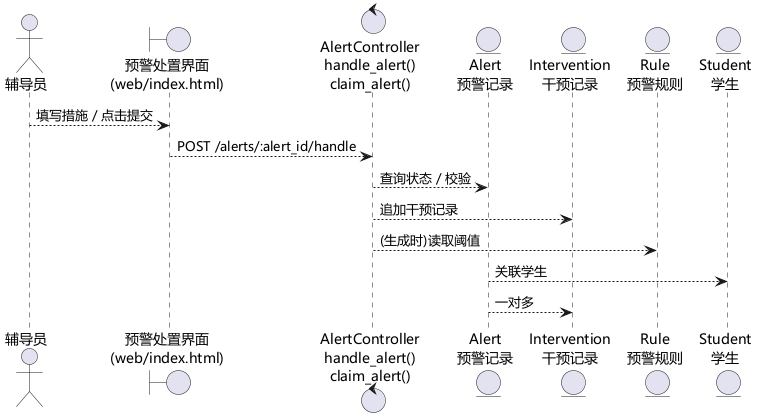
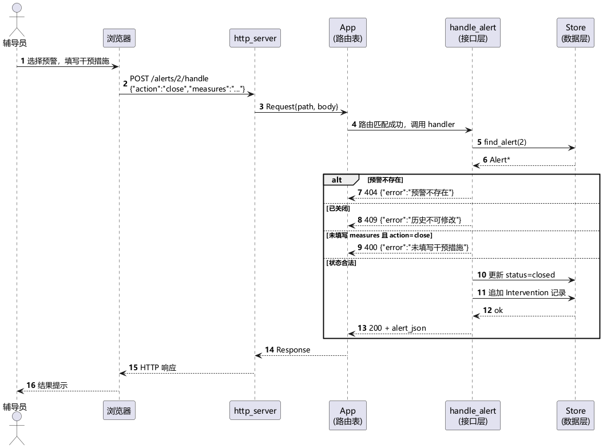
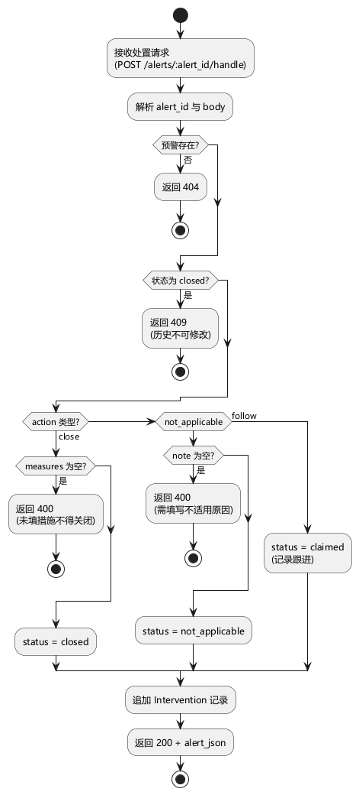
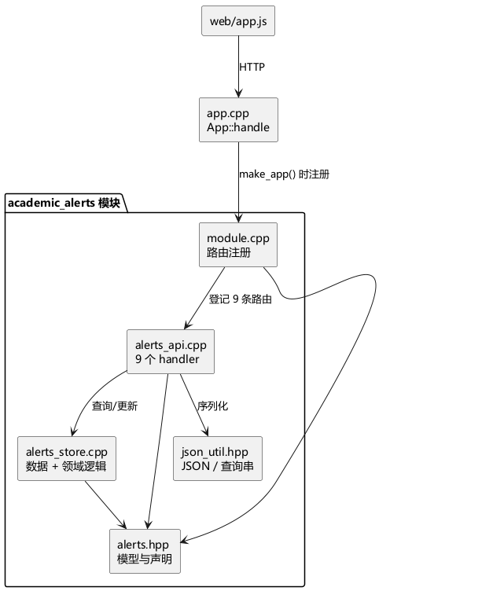

# 二、设计规格说明书（初稿 · M4 部分为主）

> 对应《实验指导书》「二、设计规格说明书」：
> 1 概述 → 2 总体设计（2.1 体系结构、2.2 模块设计）→ 3 数据库设计
>
> 状态说明：带【待组长汇总】的段落是团队级内容；其余已按 M4 模块写好，可直接改。
> 图源文件在 `diagrams/src/*.puml`，成图在 `diagrams/png/*.png`，改完跑一次 PlantUML 即可重新生成。

---

## 1. 概述

本系统是面向高校学生成长与职业发展的数据中台，向下统一接入教务、科研、实践三类数据，向上以「画像—分析—推荐—数据服务」四类能力支撑学生、辅导员、院系与就业指导中心。

本期设计范围为：数据接入（M1）、数据治理（M2）、学生画像（M3）、学业分析与预警（M4）、职业发展推荐（M5）、数据服务与权限（M6）六个模块，以及它们共用的 HTTP 接口层与前端应用层。

设计工作按「总体设计 → 模块设计 → 数据库设计」三步推进：

1. **总体设计**：先确定体系结构风格，再分别给出逻辑架构（包图）与物理架构（部署图）；
2. **模块设计**：以用例为单位，用鲁棒图与序列图把用例落到对象，归纳出设计类清单，再用活动图描述关键程序逻辑；
3. **数据库设计**：把 UML 类模型映射为关系表，给出表清单与字段级说明。

本次选择 **M4 学业分析与预警** 作为重点实现模块，设计文档以该模块为例展开。

---

## 2. 总体设计

### 2.1 体系结构设计

#### 2.1.1 架构决策与选型

**约束条件**：5 人小组、8 周、4 个 Sprint、单机部署、无专职运维；要求每个迭代都能交付可运行增量。

备选方案对比：

| 方案 | 结构 | 对约束的支持 | 结论 |
| --- | --- | --- | --- |
| A. 分层单体（内嵌 HTTP 服务） | 前端 → 接口层 → 领域层 → 数据层，单进程 | 部署零依赖、编译快、调试简单；模块间通过路由表解耦，可并行开发 | **选用** |
| B. 前后端分离 + 独立后端框架（如 Spring Boot） | 前端 Vue + 后端服务 + 数据库 | 生态成熟，但引入框架学习成本与运行时依赖，且与现有 C++ 骨架不一致 | 备选 |
| C. 微服务 | 按模块拆成多个服务，网关路由 | 扩展性好，但需服务注册、链路追踪、容器编排，8 周内无法完成且无运维支撑 | 不采用 |

**决策**：采用 **A. 分层单体**，理由：

1. 每个模块以 `module.cpp` 为注册入口，通过 `App::add_module_route` 挂到统一路由表，**模块边界清晰且互不依赖**，满足六人并行开发；
2. 单进程无外部依赖（仅 C++17 + CMake），任何人 clone 后 30 秒内可编译运行，符合「每个 Sprint 交付可运行增量」的要求；
3. 数据层当前为内存实现，接口层与存储层已解耦（`alerts_store.cpp`），后续接 MySQL 时不影响上层。

**风险与缓解**：单进程单线程在高并发下能力有限 → 本期为本地教学演示，QPS 要求低；若后续需要扩展，可按模块拆分为独立服务（方案 C），当前模块边界已为此预留。

#### 2.1.2 系统逻辑架构

采用**分层架构**，自上而下分为四层：



*图 2-1　系统逻辑架构包图（包图表示逻辑架构）*

| 层 | 包含内容 | 职责 |
| --- | --- | --- |
| 前端应用层 | `web/index.html`、`web/app.js` | 页面展示、调用接口、展示响应 |
| 接口层 | `http_server.cpp`、`app.cpp` | HTTP 解析、静态资源、路由注册与分发 |
| 领域层 | `src/modules/*`（M1～M6） | 各模块业务逻辑，模块之间不直接调用 |
| 数据层 | 内存 Store（当前）、MySQL（规划） | 数据存取 |

依赖方向严格单向：上层依赖下层，下层不感知上层；**领域层各模块之间没有直接依赖**，跨模块协作通过接口层组合（例如 M4 读取 M2 的指标值，后续通过接口或共享数据层实现）。

#### 2.1.3 系统物理架构



*图 2-2　系统物理架构部署图*

| 节点 | 部署内容 | 说明 |
| --- | --- | --- |
| 用户电脑 | 浏览器 | 访问 `127.0.0.1:8080` |
| 应用服务器 | `platform_server` 可执行文件、`web/` 静态资源 | 单进程，监听回环地址 |
| 数据库服务器 | MySQL 8 | 实验二阶段为规划，暂用内存数据替代 |

部署特点：应用只监听回环地址，外部不可访问，符合教学演示的安全要求；静态资源与接口由同一进程提供，省去 Nginx 反向代理。

### 2.2 模块设计

#### 2.2.1 用例实现（设计模型）

以 **UC-AA-05 处置预警** 为例，说明从用例到对象的实现过程。

**（1）鲁棒图**



*图 2-3　处置预警用例的鲁棒图*

| 角色 | 对象 | 说明 |
| --- | --- | --- |
| 边界类 | 预警处置界面（`web/index.html`） | 接收辅导员输入，展示结果 |
| 控制类 | `handle_alert()` / `claim_alert()` | 编排一次处置的业务流程与校验 |
| 实体类 | `Alert`、`Intervention`、`Rule`、`Student` | 保存预警状态、干预历史、规则阈值与学生信息 |

**（2）序列图**



*图 2-4　处置预警序列图（含 404 / 409 / 400 三个异常分支）*

序列图覆盖了三条异常分支，与需求文档 §3.3「UC-AA-05 关键用例规约」一一对应：预警不存在→404、已关闭→409、未填措施关闭→400。

**（3）设计类清单**

表 2-1　设计类清单（M4 模块）

| 序号 | 实体类 | 对应控制类 | 对应边界类 |
| --- | --- | --- | --- |
| 1 | `Alert`（预警记录） | `handle_alert()` | 预警处置界面 |
| 2 | `Alert`（预警记录） | `claim_alert()` | 预警列表界面 |
| 3 | `Alert`（预警记录） | `generate_alerts()` | 预警名单界面 |
| 4 | `Rule`（预警规则） | `create_rule()` / `list_rules()` | 规则配置界面 |
| 5 | `Student`（学生） | `student_trend()` | 学业趋势界面 |
| 6 | `Intervention`（干预记录） | `interventions()` | 干预跟踪界面 |
| 7 | 聚合统计（无独立实体） | `dashboard()` | 学业看板界面 |

> 说明：本模块没有独立的数据访问类，`alerts_store.cpp` 同时承担数据访问与领域判定职责；若后续接入数据库，可将其拆为 `AlertRepository`（数据访问）与 `AlertService`（业务规则）。

#### 2.2.2 关键程序逻辑设计

选取 **处置预警的状态流转** 作为关键程序逻辑，用活动图描述：



*图 2-5　处置预警关键程序逻辑活动图*

活动图体现的三条业务规则：

1. 预警已关闭 → 直接拒绝（409），历史不可修改；
2. `action=close` 但未填 `measures` → 拒绝（400），保证闭环可追溯；
3. `action=not_applicable` 必须填 `note`（转专业、休学等原因），否则拒绝。

**模块内部结构**（辅助说明实现方式）：



*图 2-6　M4 模块内部组件与依赖关系*

| 文件 | 职责 |
| --- | --- |
| `module.cpp` | 只做模块与路由注册 |
| `alerts_api.cpp` | 9 个 handler：参数校验与 JSON 组装 |
| `alerts_store.cpp` | 种子数据、查询、规则判定、状态流转 |
| `alerts.hpp` | 领域模型与函数声明 |
| `json_util.hpp` | JSON 转义/解析、查询串解析 |

---

## 3. 数据库设计

### 3.1 数据库表设计

**映射方案**：UML 类模型中的每个实体类映射为一张表；一对多用外键表达；枚举型属性（等级、状态、动作）用短字符串存储，便于扩展且可读；规则阈值用 `DECIMAL(10,2)` 保证精度。

表 2-2　数据库表名清单

| 序号 | 中文表名 | 英文表名 | 表功能说明 |
| --- | --- | --- | --- |
| 1 | 学生表 | `student` | 学生基础信息（由 M1/M3 维护，M4 只引用） |
| 2 | 预警规则表 | `alert_rule` | 规则名称、指标、运算符、阈值、等级、通知对象 |
| 3 | 预警记录表 | `alert_record` | 一次预警的触发快照与处置状态 |
| 4 | 干预记录表 | `intervention_record` | 认领、跟进、关闭等处置留痕 |

### 3.2 数据库表的详细清单

表 2-3　表名：`alert_rule`（预警规则表）

| 序号 | 字段中文名 | 字段英文名 | 类型、宽度、精度 | 取值约束 | 空否 | 默认值 | 主键/外键 | 索引否 |
| --- | --- | --- | --- | --- | --- | --- | --- | --- |
| 1 | 规则ID | `id` | BIGINT | 自增 | 否 | — | PK | 是 |
| 2 | 规则编码 | `rule_code` | VARCHAR(16) | R1、R2… | 否 | — | — | 唯一索引 |
| 3 | 规则名称 | `name` | VARCHAR(64) | — | 否 | — | — | 否 |
| 4 | 指标 | `metric` | VARCHAR(32) | avg_score/failed_courses/credit_rate/attendance | 否 | — | — | 是 |
| 5 | 运算符 | `operator` | VARCHAR(8) | lt/lte/gt/gte | 否 | lt | — | 否 |
| 6 | 阈值 | `threshold` | DECIMAL(10,2) | ≥0 | 否 | 0 | — | 否 |
| 7 | 预警等级 | `level` | VARCHAR(8) | red/orange/yellow | 否 | yellow | — | 是 |
| 8 | 通知对象 | `notify_target` | VARCHAR(128) | — | 是 | NULL | — | 否 |
| 9 | 是否启用 | `enabled` | TINYINT | 0/1 | 否 | 1 | — | 是 |
| 10 | 创建时间 | `created_at` | DATETIME | — | 否 | CURRENT_TIMESTAMP | — | 否 |

索引：主键索引 `PRIMARY(id)`；唯一索引 `uk_rule_code(rule_code)`；普通索引 `idx_metric_level(metric, level)`。

表 2-4　表名：`alert_record`（预警记录表）

| 序号 | 字段中文名 | 字段英文名 | 类型、宽度、精度 | 取值约束 | 空否 | 默认值 | 主键/外键 | 索引否 |
| --- | --- | --- | --- | --- | --- | --- | --- | --- |
| 1 | 预警ID | `id` | BIGINT | 自增 | 否 | — | PK | 是 |
| 2 | 学号 | `student_id` | VARCHAR(20) | — | 否 | — | FK → student | 是 |
| 3 | 规则ID | `rule_id` | BIGINT | — | 否 | — | FK → alert_rule | 是 |
| 4 | 预警等级 | `level` | VARCHAR(8) | red/orange/yellow | 否 | — | — | 是 |
| 5 | 处置状态 | `status` | VARCHAR(16) | open/claimed/closed/not_applicable | 否 | open | — | 是 |
| 6 | 触发时指标值 | `metric_value` | DECIMAL(10,2) | — | 否 | — | — | 否 |
| 7 | 触发时间 | `created_at` | DATETIME | — | 否 | CURRENT_TIMESTAMP | — | 是 |
| 8 | 认领人 | `assignee` | VARCHAR(32) | — | 是 | NULL | — | 否 |
| 9 | 关闭时间 | `closed_at` | DATETIME | — | 是 | NULL | — | 否 |

索引：主键 `PRIMARY(id)`；外键索引 `idx_student(student_id)`、`idx_rule(rule_id)`；查询索引 `idx_status_created(status, created_at)`（用于「超时未处置」提醒）。

表 2-5　表名：`intervention_record`（干预记录表）

| 序号 | 字段中文名 | 字段英文名 | 类型、宽度、精度 | 取值约束 | 空否 | 默认值 | 主键/外键 | 索引否 |
| --- | --- | --- | --- | --- | --- | --- | --- | --- |
| 1 | 记录ID | `id` | BIGINT | 自增 | 否 | — | PK | 是 |
| 2 | 预警ID | `alert_id` | BIGINT | — | 否 | — | FK → alert_record | 是 |
| 3 | 处置动作 | `action` | VARCHAR(16) | claim/follow/close/not_applicable | 否 | — | — | 否 |
| 4 | 干预措施 | `measures` | VARCHAR(500) | 关闭时非空 | 是 | NULL | — | 否 |
| 5 | 备注/原因 | `note` | VARCHAR(500) | 不适用时非空 | 是 | NULL | — | 否 |
| 6 | 操作人 | `operator` | VARCHAR(32) | — | 否 | — | — | 是 |
| 7 | 操作时间 | `created_at` | DATETIME | — | 否 | CURRENT_TIMESTAMP | — | 是 |

索引：主键 `PRIMARY(id)`；外键索引 `idx_alert(alert_id)`；`idx_alert_created(alert_id, created_at)` 用于按时间顺序回放干预历史。

**约束说明**：

1. `alert_record(student_id, rule_id, status)` 上加唯一约束（`status` 为 open/claimed 时）由应用层保证「生成预警幂等」，数据库层可用部分索引或触发器实现；
2. `intervention_record.measures` 的非空校验在应用层完成（关闭动作必须填写），数据库层保留 NULL 以兼容跟进类记录；
3. 学生表由 M1/M3 负责，M4 仅通过 `student_id` 引用，不做跨模块外键强约束，避免模块间强耦合。

---

## 附：图表清单与生成方式

| 图号 | 文件 | 类型 | 说明 |
| --- | --- | --- | --- |
| 图2-1 | `diagrams/png/package_arch.png` | 包图 | 逻辑架构 |
| 图2-2 | `diagrams/png/deploy.png` | 部署图 | 物理架构 |
| 图2-3 | `diagrams/png/robust_m4_handle.png` | 鲁棒图 | 处置预警 |
| 图2-4 | `diagrams/png/seq_m4_handle.png` | 序列图 | 处置预警 |
| 图2-5 | `diagrams/png/act_m4_handle.png` | 活动图 | 关键程序逻辑 |
| 图2-6 | `diagrams/png/component_m4.png` | 组件图 | 模块内部结构 |

重新生成（PlantUML jar 体积大，不入库，用本机任意一份即可）：

```bash
cd docs/exp2/diagrams/src
java -jar /path/to/plantuml.jar -charset UTF-8 -tpng -o ../png *.puml
```
